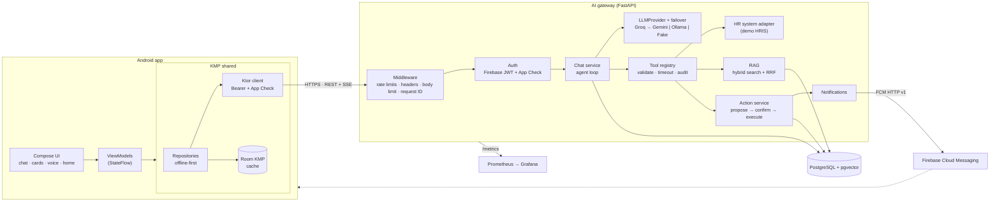
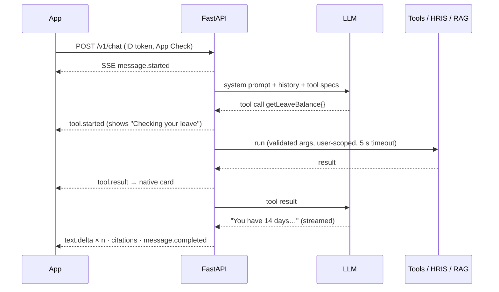
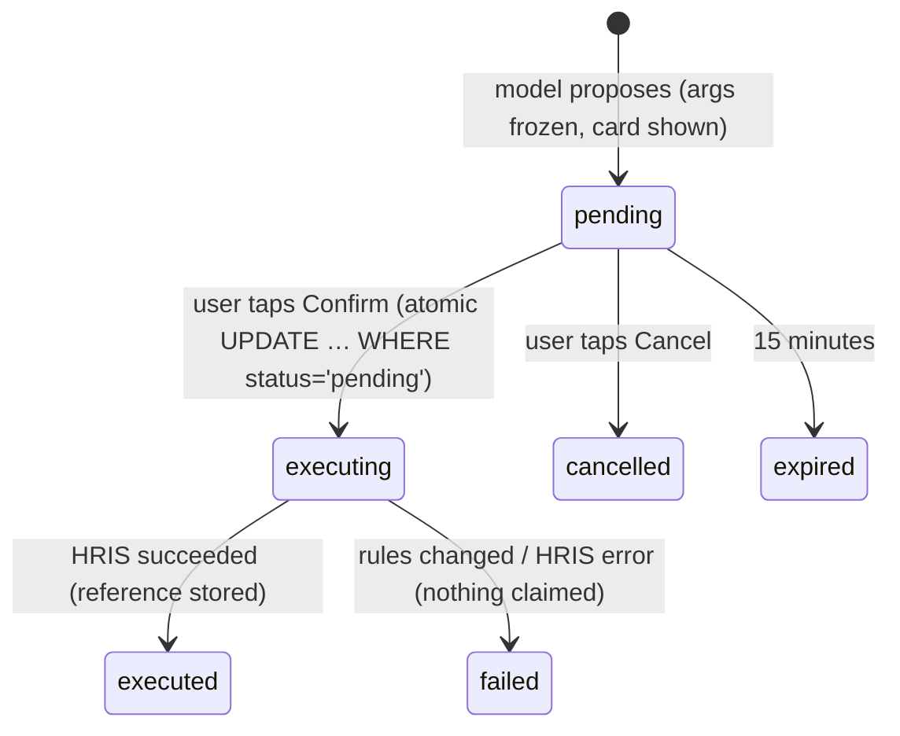

# Keystone — AI HR Assistant

An AI assistant for employees, on Android, built with Kotlin Multiplatform. You can ask by text or voice about leave, HR requests, onboarding tasks and company policy. Keystone answers from **live HR data through tool calling** and from **company documents through RAG, with verified citations**. It streams every reply and renders real app UI (cards, sources, confirmations) instead of only text. It can also **act**: book leave or raise a request, always after your tap to confirm, never on its own.

> Status: **complete** (Phases 0–8). Built as a portfolio project, using free tools only.

| | |
| --- | --- |
| **Mobile** | Kotlin, Jetpack Compose, Material 3, Kotlin Multiplatform (shared domain, Ktor, Room KMP), Hilt, Coroutines/Flow |
| **Backend** | Python 3.12, FastAPI, Pydantic v2, SQLAlchemy async, Alembic, PostgreSQL 16 + pgvector |
| **AI** | Provider-agnostic `LLMProvider`: Ollama locally (qwen2.5 + nomic-embed-text); in the cloud Groq for chat with automatic failover to Gemini, Gemini embeddings; own agent loop, no framework |
| **Platform** | Firebase Auth, FCM, App Check · Docker · GitHub Actions · Render + Neon (free) · Prometheus + Grafana |

## What it does

- **Streaming chat** over Server-Sent Events. Answers appear token by token and can be stopped. Retries are idempotent, and history works offline.
- **Tool calling with generative UI.** "How many leave days do I have?" calls `getLeaveBalance` and renders a native balance card. There are 12 tools: profile, leave, HR requests, tasks, meetings, notifications, policy search and four actions.
- **RAG with citations.** Hybrid search (pgvector + full text, fused with RRF) over the policy documents. Citations are checked by the server, so the model can't invent a source. Tapping a citation opens the document at that passage.
- **Actions with confirmation.** The model proposes a change and the app shows exactly what will happen. Your tap runs it once (atomic compare-and-set, idempotent, expiring, re-validated).
- **Voice.** On-device speech recognition and speech output while the answer streams, sentence by sentence. Barge-in is supported, and it respects TalkBack.
- **Home dashboard.** "Needs your attention" items, prioritised by the server and cached offline. **Push notifications** never reveal HR data on the lock screen.
- **Production hardening.** Layered rate limits, Firebase App Check, strict HTTP headers, body limits, Prometheus metrics, dependency audit, secret scanning, Dependabot, release signing outside git.

## Architecture



The app **never holds an AI key**. It sends a Firebase ID token and an App Check token, and the backend owns models, prompts, tools and data access. Changing the LLM vendor means changing one adapter and one environment variable.

### One chat turn



### Confirmed actions



## Security model

| Threat | Control |
| --- | --- |
| Extracting AI keys from the APK | No keys in the app. All model calls are server-side |
| Stolen or forged sign-in | Firebase ID tokens verified (signature, audience, issuer, expiry); `dev` auth refused in production |
| Scripts replaying a stolen token | Firebase App Check (Play Integrity), rolled out monitor → enforce |
| Quota exhaustion and floods | Token buckets per IP, per user, per chat and per action; bounded memory; forge-proof client IP |
| Prompt injection changing data | The model can only *propose*. Execution requires the user's confirm call with frozen arguments |
| Data leaks between users | Every tool and query is scoped to the authenticated user; cross-user tests |
| Hallucinated sources | Citations are verified against retrieved passages on the server |
| Lock-screen and third-party exposure | Push payloads are generic, and details load behind sign-in |
| Secrets in git | `.env`, keys and keystores gitignored; gitleaks in CI; Render secrets and Secret Files |
| Vulnerable dependencies | `pip-audit` in CI (weekly too) and Dependabot for uv, Gradle, Docker and Actions |
| Logging sensitive data | Logs carry request IDs and codes, never message text, tokens or keys |

## Repository layout

| Path | What lives there |
| --- | --- |
| `backend/` | FastAPI gateway, agent, tools, RAG, migrations, tests, Dockerfile, `start.sh` |
| `backend/knowledge/` | Fictional HR policy documents and the retrieval eval set |
| `mobile/` | Android app, KMP `shared` module, design system |
| `contracts/` | API and stream contract, with fixtures that both test suites load |
| `docs/phases/` | What each phase built, why, how to run it, interview notes |
| `docs/adr/` | 16 Architecture Decision Records |
| `docs/deployment.md` | Free cloud deployment, step by step |
| `docs/demo-script.md` · `docs/interview-cheatsheet.md` | 3-minute demo and interview prep |
| `ops/` | Prometheus config and the Grafana dashboard |
| `render.yaml` · `scripts/smoke_test.py` | Cloud blueprint and post-deploy checks |

## Run it locally

Prerequisites: Docker Desktop, Android Studio, JDK 17. For real AI: [Ollama](https://ollama.com) with `ollama pull qwen2.5:7b && ollama pull nomic-embed-text`. Or use `LLM_PROVIDER=fake` with no model at all.

```bash
cp backend/.env.example backend/.env
docker compose up --build                       # API on :8000 (migrates + loads the policies)
curl localhost:8000/readyz

docker compose --profile observability up -d    # + Prometheus :9090 and Grafana :3000
```

Android: follow `docs/firebase-setup.md` once (free Firebase project, `google-services.json`), open `mobile/` in Android Studio and run `androidApp` on an emulator.

Try: "How many leave days do I have left?" · "Can I carry over unused leave?" · "Book annual leave on Monday and Tuesday after next" · tap the mic and ask by voice.

Cloud: see [docs/deployment.md](docs/deployment.md) (Render + Neon + Groq + Gemini, all free).

## Tests and quality

| Suite | What |
| --- | --- |
| Backend: **240 tests** (with Postgres) | API contracts, streaming, agent loop, every tool, RAG + retrieval eval (hit@k, MRR), actions (races, idempotency, expiry), home, push, security (headers, limits, App Check), metrics, Gemini and Groq adapters and cross-vendor failover (mocked HTTP), migrations (`alembic check`) |
| Mobile: **134 tests** | KMP repositories (Ktor MockEngine), SSE parser and contract fixtures, sentence chunker, App Check and bearer plugins, ViewModels with fakes and virtual time, error copy |
| Static | ruff, ruff format, strict mypy, Android Lint, unsigned minified release build |
| Supply chain | pip-audit, gitleaks, Dependabot |

```bash
cd backend && uv run pytest            # RUN_INTEGRATION=1 with a Postgres for the DB tests
cd mobile && ./gradlew :shared:testDebugUnitTest :androidApp:testDebugUnitTest
```

## Roadmap (all done)

| Phase | Scope |
| --- | --- |
| 0 | Foundations: repo, backend skeleton, KMP + Android skeleton, CI |
| 1 | Streaming chat (SSE, provider abstraction, Fake + Ollama) |
| 2 | Firebase sign-in, conversations, offline cache |
| 3 | Tool calling + generative UI cards |
| 4 | RAG over HR documents with verified citations |
| 5 | Write actions with user confirmation |
| 6 | Voice |
| 7 | Home dashboard + push notifications |
| 8 | Security hardening, observability, free cloud deployment, demo |

Next ideas: an iOS app on the same KMP core, OpenTelemetry tracing, a Redis rate limiter for multiple instances, and a real HRIS integration through signed webhooks.

## Key decisions

See [docs/adr](docs/adr/README.md). Highlights: a Python gateway owns all AI; SSE over WebSockets; pgvector instead of a separate vector database; no agent framework; tools as the only data access; propose/confirm for writes; on-device voice; generic push; layered rate limits with App Check; free hosting with multi-vendor AI failover.
